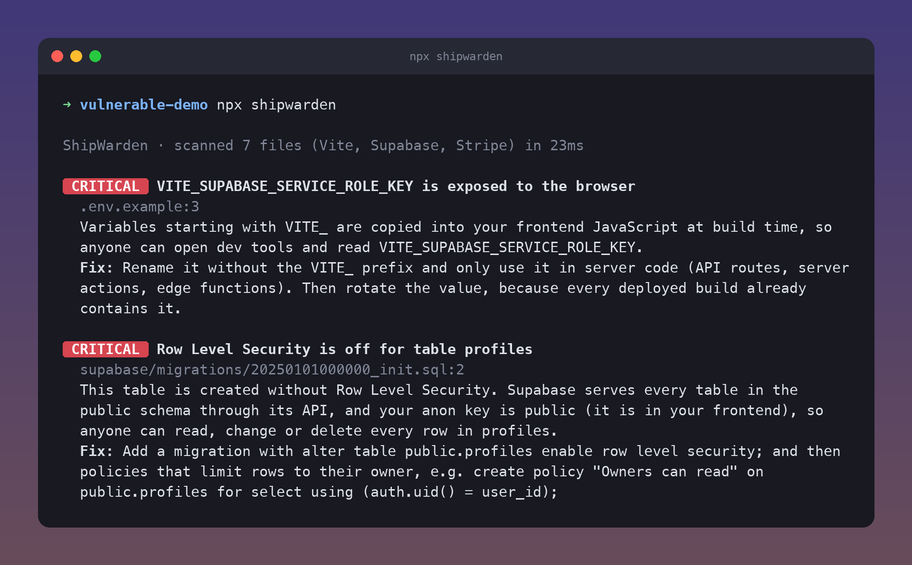

# ShipWarden

**Find the security holes AI coding tools leave in your app, before someone else does.**

Lovable, Bolt, Cursor, v0 and friends make the same handful of mistakes over and over: Supabase tables anyone can edit, `service_role` keys shipped to the browser, Firebase rules left in test mode, webhooks that trust anyone. ShipWarden checks for exactly those, in about a second, for free.

```bash
npx shipwarden
```

- **Free and open source.** No account, no signup, no limits.
- **Your code stays on your machine.** Nothing is uploaded unless you turn on the optional AI review.
- **Quiet by design.** A handful of findings you should actually fix, written for founders rather than security teams.



Try it on the bundled demo: `npx shipwarden examples/vulnerable-demo`

## What it checks

| Check | Why it matters |
|---|---|
| Supabase table without Row Level Security | Your anon key is public, so every row is readable and writable by anyone. Migrations are replayed in order, including `DO` blocks and RLS loops. |
| RLS policy with `using (true)` | The classic AI-written "System can manage X" policy: anyone can edit or delete everything. |
| View or materialized view that bypasses RLS | Views run as their owner unless `security_invoker` is on. Views closed to `anon`, or that filter by `auth.uid()`, are reported as low "check this" items. |
| Supabase Storage policy with no owner check | Lets anyone (or any logged-in user) overwrite or delete other people's files, upload to your buckets, or read private buckets. |
| `security definer` function without a fixed `search_path` | It runs as its owner and skips RLS, so it should never look objects up through the caller's search_path. |
| `service_role` key in the code | Decoded from the JWT itself, so the public `anon` key never triggers it. |
| Secrets behind `NEXT_PUBLIC_` / `VITE_` / `EXPO_PUBLIC_` | These are baked into your frontend bundle. |
| AI SDK with `dangerouslyAllowBrowser` | Your OpenAI/Anthropic key ships to every visitor. |
| Hardcoded live keys | Stripe, OpenAI, Anthropic, Supabase secret keys, AWS, GitHub, Slack, SendGrid, private keys. |
| Committed `.env` files | Only when they contain non-public values. |
| Firebase rules: open, test mode, or "any signed-in user" catch-alls | Firestore, Storage and Realtime Database. |
| API route, server action or Edge Function that writes data with no auth check | Especially when it uses the admin client, which skips RLS. Auth helpers in files you import, signed webhooks and token links (unsubscribe, email confirm) count as checks. |
| Stripe webhook without signature verification | Anyone can fake a "payment succeeded" event. |
| `supabase.auth.getSession()` trusted on the server | Supabase says to use `getUser()` there. |
| Raw SQL built from string interpolation | SQL injection. |
| `dangerouslySetInnerHTML` without sanitizing | XSS. |

## Launch checklist

On a full scan, ShipWarden also checks for the launch basics AI tools usually skip. Each check only runs when it applies: password reset only matters if users log in with a password, and terms of service only matter if you take payments. These never fail a build.

| Item | Checked when | Priority |
|---|---|---|
| 404 page | always | must have for single-page apps |
| Error page / error boundary | Next.js and React apps | must have for single-page apps |
| Privacy policy | the app has accounts, payments or analytics | must have |
| Terms of service | the app takes payments | must have |
| Password reset | users sign in with a password | must have |
| Rate limits on paid AI calls | server code calls OpenAI, Anthropic, Gemini, the Lovable AI gateway and similar | must have |
| Your own title, description and favicon | always (catches Lovable, v0, Vite and Create Next App defaults) | must have |
| Account deletion | the app has accounts | nice to have |
| Social preview image | always | nice to have |
| robots.txt and sitemap | always | nice to have |
| Error monitoring | the app has accounts or payments | nice to have |

```
Launch checklist · 3 of 10 done · 4 must-haves missing

  MUST HAVE  No rate limit on paid AI calls  supabase/functions/chat/index.ts:2
  Your server calls a paid AI API with nothing limiting how often. One script hitting that
  endpoint in a loop can run up a bill of thousands overnight.
  Fix: Limit requests per user or IP (e.g. @upstash/ratelimit, or a daily quota per user ...
```

Turn an item off with `--skip-check <id>` or a `check:<id>` line in `.shipwardenignore`, or the whole checklist with `--no-checklist`. Libraries and CLIs (anything that isn't a web app) get no checklist.

## Add it to GitHub (runs on every pull request)

Create `.github/workflows/shipwarden.yml`:

```yaml
name: ShipWarden
on:
  pull_request:
  push:
    branches: [main]

permissions:
  contents: read
  pull-requests: write

jobs:
  scan:
    runs-on: ubuntu-latest
    steps:
      - uses: actions/checkout@v5
      - uses: patrickballard/shipwarden@v0
```

On a pull request, ShipWarden only reports security problems in files the PR changes, and leaves out the launch checklist, which is about the whole codebase. Pushes to `main` run a full scan with the checklist in the job summary. It flags them inline on the diff and keeps one summary comment up to date instead of posting a new one on every push. It fails the check on critical findings.

| Input | Default | |
|---|---|---|
| `fail-on` | `critical` | Fail when a finding is at least this severe: `critical`, `high`, `medium`, `low` or `none`. |
| `scope` | `changed` | `all` reports on the whole repo on pull requests too. |
| `comment` | `true` | Post the summary comment on pull requests. |
| `ignore` | | Extra globs to skip, comma or newline separated. |
| `checklist` | `true` | Run the launch checklist on full scans (pushes, schedules, `scope: all`). |
| `skip-checks` | | Checklist item ids to turn off, e.g. `robots-sitemap, error-monitoring`. |
| `anthropic-api-key` | | Turns on the optional AI review (below). |
| `ai-model` | `claude-opus-5-5` | Claude model for the AI review. |

Outputs: `findings`, `critical`, `high`.

## Silencing a finding

- Put `// shipwarden-ignore` (or `-- shipwarden-ignore` in SQL) on the line above, or at the end of the line. Add a rule id, such as `shipwarden-ignore xss-unsanitized-html`, to silence just that rule.
- List paths in `.shipwardenignore`, which uses the same syntax as `.gitignore`.
- Test files and fixtures are skipped automatically.

## Optional: AI review

Some checks are heuristics: "this endpoint has no auth check" might be wrong if auth happens in a helper. With an Anthropic API key, ShipWarden sends **only those uncertain findings** to Claude, with the relevant file and your `middleware.ts`, and drops the ones it rules out. High-confidence findings, like a table without RLS, are never sent and can never be dismissed.

```bash
ANTHROPIC_API_KEY=sk-ant-... npx shipwarden --ai
```

In the Action, set `anthropic-api-key: ${{ secrets.ANTHROPIC_API_KEY }}`. A review is a single API call per run, and is skipped entirely when nothing is uncertain. To cut cost further, set `ai-model` / `--model` to `claude-haiku-5-5`.

## CLI

```
shipwarden [path] [--format text|json|markdown] [--fail-on <severity|none>] [--ignore <glob>]
           [--no-checklist] [--skip-check <id>] [--ai] [--model <id>]
```

Exit code 1 means a security finding is at or above `--fail-on` (default `critical`). The checklist never changes the exit code.

## Limitations

ShipWarden reads your repository. It can't see changes made directly in the Supabase or Firebase dashboard that never landed in a migration or rules file. It's a fast first line of defence, not a penetration test.

## Development

```bash
npm test
node src/cli.js examples/vulnerable-demo
```

Zero runtime dependencies for the scanner; `@anthropic-ai/sdk` is only loaded for `--ai`.

MIT licensed.
